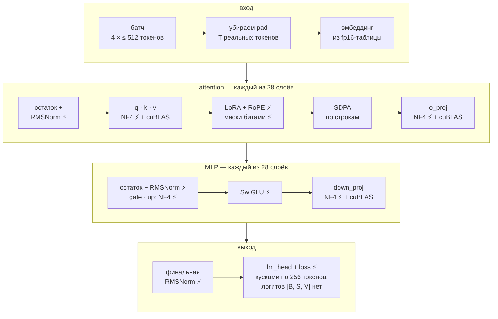
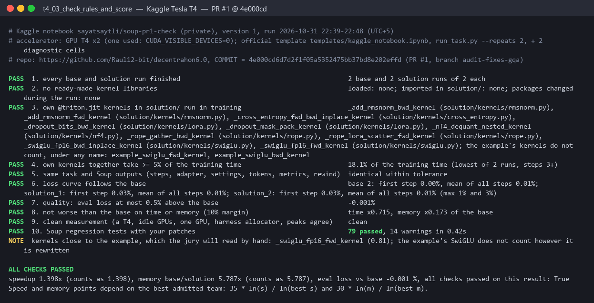
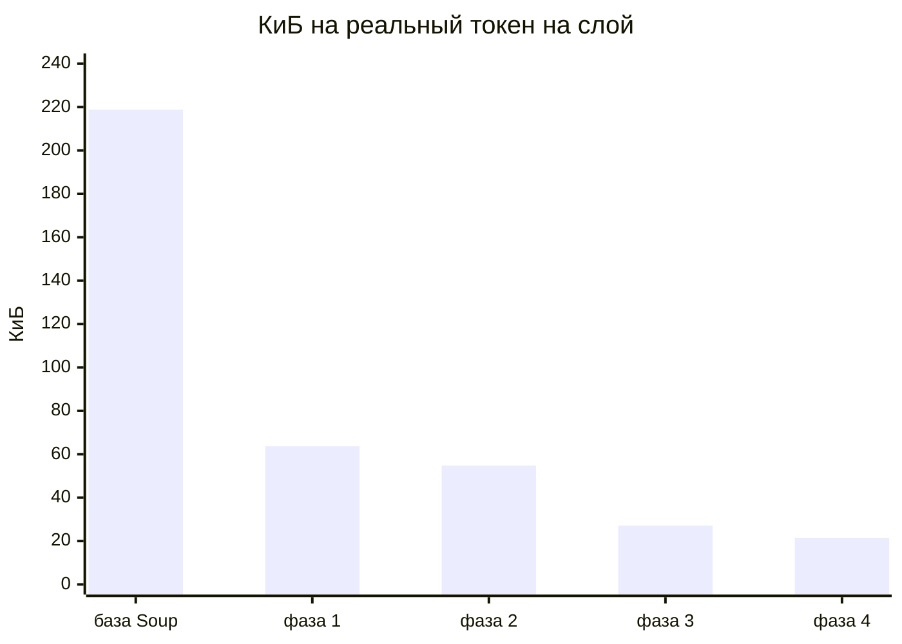

<div align="center">

# Soup Kernel Challenge: Triton-кернелы для `soup train` на Kaggle T4

**Decentrathon 6.0 · кейс [Soup](https://github.com/MakazhanAlpamys/Soup)**

Тот же запуск `soup train` (Qwen2.5-1.5B-Instruct, NF4, LoRA r=16 на `q_proj`/`v_proj`, batch 4,
до 512 токенов, 64 шага) на бесплатной Tesla T4: **в 1,4 раза быстрее**, пик памяти **в 5,8 раза
меньше**, адаптер того же качества.

[](#результаты-на-kaggle-t4)
[](#результаты-на-kaggle-t4)
[](#результаты-на-kaggle-t4)
[](#результаты-на-kaggle-t4)
<br>
[](#как-запустить)
[](solution/kernels/)
[](#наши-кернелы)
[](LICENSE)

</div>

| | База Soup 0.77.0 | Наше решение | Итог |
|---|---:|---:|:---|
| Время `soup train`, с | 84,83 | **60,69** | **×1,398 быстрее** |
| Пик памяти GPU (nvidia-smi), МиБ | 14 345 | **2 479** | **×5,787 меньше** |
| Медиана шага обучения, с | 0,90 / 0,99 | **0,51 / 0,54** | ×1,81 |
| Eval loss на публичных строках | 2,04967 | **2,04965** | −0,001% |
| Проверки `harness/check_rules.py` | | **10 из 10** | `ALL CHECKS PASSED` |
| Доля наших кернелов во времени обучения | | **18,1%** | порог 5% |

<sub>Kaggle, GPU T4 x2 (используется одна), шаблонный ноутбук, `python harness/run_task.py --repeats 2`
(база → решение → решение → база, как у жюри), 31 октября 2026, коммит `4e000cd`. Время и пик:
медиана и максимум двух запусков.</sub>

- **Финальный коммит:** последний коммит ветки [`main`](https://github.com/Raul12-bit/decentrahon6.0/commits/main).
  Его `solution/` побайтно тот же, что в замеренном коммите
  [`4e000cd`](https://github.com/Raul12-bit/decentrahon6.0/commit/4e000cd) (sha256 папки
  `4028fbb2…`, как считает `check_rules.py`); после него менялись только README и SUBMISSION.md.
- **Kaggle-ноутбук** (официальный шаблон, публичный):
  https://www.kaggle.com/code/ff3923/soup-kernel-challenge-t4-submission. Его сохранённая версия
  сделана на коммите `b21090d` (фаза 3); замер финального кода — в таблице выше.
- **Всё решение** — пакет [`solution/`](solution/), подключается одной функцией `solution.apply()`.

## Содержание

[Узкие места базы](#где-теряет-время-и-память-базовый-soup) ·
[Как устроено](#как-устроено-решение) ·
[Наши кернелы](#наши-кернелы) ·
[Оптимизации](#оптимизации-поверх-кернелов) ·
[Качество](#как-сохраняется-качество) ·
[Результаты](#результаты-на-kaggle-t4) ·
[Как запустить](#как-запустить) ·
[Проверка](#проверка) ·
[Структура](#структура-репозитория) ·
[Ограничения](#ограничения-и-что-дальше)

## Где теряет время и память базовый Soup

Профиль базы из условия: ~36% времени шага — матричные умножения, **~44% — мелкие поэлементные
операции и приведения типов**, ~7% — softmax/CE по словарю из 151 936 токенов, ~5% — attention,
~5% — распаковка NF4; **пик памяти ~14,3 из 15 ГБ**. Разбор исходников Soup 0.77.0,
transformers 5.16.1, peft 0.20.0 и bitsandbytes 0.50.2 показал три причины:

1. **Логиты `[B, S, V]` живут в нескольких копиях.** `ForCausalLMLoss` делает fp32-копию и хранит
   `log_softmax`, accelerate переводит выход модели в fp32, TRL делает ещё одну `contiguous`-копию,
   backward выделяет два fp32-градиента. При 2048 токенах каждая копия занимает 1,24 ГБ.
2. **Остаточный поток и MLP в fp32.** `prepare_model_for_kbit_training` держит эмбеддинг и нормы в
   fp32, а bitsandbytes возвращает проекцию в dtype входа. Поэтому RMSNorm, RoPE, сложение LoRA и
   SwiGLU идут цепочками fp32-кернелов PyTorch, а MLP хранит три fp32-тензора `[токены, 8960]` на слой.
3. **Паддинг.** Батч дополняется до самой длинной строки: на данных задачи 43% позиций — pad.

## Как устроено решение

Быстрый путь — свой forward 4-битной Qwen2 + LoRA для обучающего шага. Всё, что относится к
отдельным токенам, видит только реальные токены, а там, где база гоняла цепочки fp32-операций,
работает один наш кернел.



⚡ — наш Triton-кернел (имена — в таблице ниже). В backward работают парные кернелы
(`_add_rmsnorm_bwd_kernel`, `_rope_gather_bwd_kernel`, `_dropout_bits_bwd_kernel`,
`_swiglu_fp16_bwd_inplace_kernel`), веса NF4 распаковываются заново вместо хранения плотной копии,
а градиент по логитам уже посчитан в forward.

### Наши кернелы

| Кернел (`@triton.jit`) | Файл | Что заменяет |
|---|---|---|
| `_cross_entropy_fwd_bwd_inplace_kernel` | [`kernels/cross_entropy.py`](solution/kernels/cross_entropy.py) | Логиты `[B, S, V]` и их fp32-копии, `ForCausalLMLoss`, энтропию и точность TRL, потери строк для rewind. Один проход по словарю: online max / sum-exp, энтропия, argmax и CE в fp32; вторым проходом `dL/dz` пишется **на месте** логитов |
| `_nf4_dequant_nested_kernel` | [`kernels/nf4.py`](solution/kernels/nf4.py) | Три кернела bitsandbytes (8-битный absmax → `+ offset` → NF4) за один проход, результат **побитно** равен `dequantize_4bit`; 392 запуска за шаг |
| `_add_rmsnorm_fwd_kernel`, `_add_rmsnorm_bwd_kernel` | [`kernels/rmsnorm.py`](solution/kernels/rmsnorm.py) | Сложение остатка + `Qwen2RMSNorm` (цепочка fp32-кернелов), fp16-выход прямо в MLP; backward по замкнутой формуле; пересборка входа LoRA в backward |
| `_rope_lora_scatter_fwd_kernel`, `_rope_gather_bwd_kernel` | [`kernels/rope.py`](solution/kernels/rope.py) | Сложение LoRA + `apply_rotary_pos_emb` + каст в fp16 + раскладку под SDPA; backward — сопряжённый поворот (`−sin`), активации RoPE не хранятся |
| `_dropout_mask_pack_kernel`, `_dropout_bits_bwd_kernel` | [`kernels/lora.py`](solution/kernels/lora.py) | Маски LoRA-dropout: 8 элементов в байте вместо байта на элемент; в backward одна распаковка с масштабом dropout вместо цепочки `torch.where` |
| `_swiglu_fp16_fwd_kernel`, `_swiglu_fp16_bwd_inplace_kernel` | [`kernels/swiglu.py`](solution/kernels/swiglu.py) | `silu(g)·u` в fp16 с backward на месте. *Это вариант SwiGLU из примера стартового кита — в долю своих кернелов мы его не засчитываем* |

Без SwiGLU наши кернелы всё равно занимают ~14% времени обучения — почти втрое больше порога.

### Оптимизации поверх кернелов

| Оптимизация | Что даёт | Выключатель |
|---|---|---|
| Удаление pad-токенов | нормы, проекции, LoRA, MLP, lm_head и loss видят только реальные токены | `SOUP_KERNELS_UNPAD=0` |
| Attention по строкам без pad | работа attention — 42% от паддированной; +9% скорости, −774 МиБ пика | `SOUP_KERNELS_VARLEN_ATTN=0` |
| Норма после attention внутри MLP | нет fp32-выхода нормы и кернела каста; +7% скорости | `SOUP_KERNELS_FUSED_MLP_NORM=0` |
| Пересчёт gate/up в backward | −1,2 ГиБ пика ценой ~3% скорости | `SOUP_KERNELS_MLP_RECOMPUTE=0` |
| Вход LoRA пересобирается в backward (фаза 3) | побитно тот же вход; +6% скорости, −890 МиБ пика | `SOUP_KERNELS_LORA_REMAT=0` |
| Маски dropout битами (фаза 4) | −2,6 КиБ на токен на слой | `SOUP_KERNELS_PACKED_MASKS=0` |
| fp16-дельта attention вместо fp32-остатка (фаза 4) | −3 КиБ на токен на слой | `SOUP_KERNELS_RESID_DELTA=0` |
| Таблица эмбеддинга в fp16 | 467 МБ вместо 933 МБ; после обучения остаётся в fp16 (−360 МиБ пика на T4) | `SOUP_KERNELS_FP16_EMBED=0` |
| Прекомпиляция во время загрузки модели | ~8 с компиляции идут параллельно загрузке, обучение ждёт 1–2 с | `SOUP_KERNELS_WARMUP=0` |
| k/v без разворачивания (`enable_gqa`) | −5 КиБ на токен на слой на GPU sm_80+; **на T4 самопроверка его выключает** | `SOUP_KERNELS_GQA_ATTN=0` |

<details>
<summary><b>Подробно о каждом изменении</b></summary>

| Что | Где | Как устроено |
|---|---|---|
| lm_head + CE + метрики по чанкам | [`kernels/cross_entropy.py`](solution/kernels/cross_entropy.py) | Логиты считаются кусками по 256 токенов (cuBLAS fp16). Кернел `_cross_entropy_fwd_bwd_inplace_kernel` (одна программа на токен) за один проход по словарю считает online max / sum-exp в fp32, энтропию (`entropy` TRL), argmax (`mean_token_accuracy` TRL) и CE токена (потери строк для `rewind.jsonl`), вторым проходом **на месте** записывает `dL/dz` поверх логитов, затем cuBLAS даёт градиент по скрытому состоянию. Тензор `[B, S, V]` не создаётся вообще. Градиент строится только для строк с меткой (они сортируются вперёд). |
| RMSNorm + сложение остатка | [`kernels/rmsnorm.py`](solution/kernels/rmsnorm.py) | `_add_rmsnorm_fwd/bwd_kernel`: `resid + delta` (fp32 + fp16) и нормализация за один проход, `rstd` в fp32; выход в dtype выходного тензора (fp32 для входа attention, где его читает LoRA-dropout; fp16 перед MLP); backward по замкнутой формуле, сразу отдаёт градиент и остатку, и fp16-выходу блока. |
| LoRA-сложение + RoPE + раскладка | [`kernels/rope.py`](solution/kernels/rope.py) | `_rope_lora_scatter_fwd_kernel`: `fp32(base) + fp32(lora)`, поворот `q·cos + rotate_half(q)·sin` в fp32 и запись **сразу в fp16** в раскладку, которую читает SDPA: в базе autocast округляет fp32-результат RoPE до fp16 ровно в этой точке, поэтому значения те же, а fp32-копий q/k/v и трёх кернелов приведения нет (в обе стороны). Backward (`_rope_gather_bwd_kernel`) читает fp16-градиент SDPA и применяет сопряжённый поворот (`-sin`) в fp32 — активации RoPE не хранятся. GQA: одна компиляция на q и k/v. |
| SwiGLU в fp16 | [`kernels/swiglu.py`](solution/kernels/swiglu.py) | `silu(g)·u` из fp16-выходов GEMM, математика в fp32, сохраняются только `g` и `u`, backward пишет `dg`, `du` поверх них. *Вариант SwiGLU из примера стартового кита, в долю своих кернелов не засчитываем.* |
| NF4 + double quant | [`kernels/nf4.py`](solution/kernels/nf4.py) | `_nf4_dequant_nested_kernel` за один проход делает то, на что bitsandbytes тратит три кернела: декодирует 8-битный absmax (`code2[a8]·absmax2 + offset`), оба полубайта через таблицу NF4 и пишет fp16-веса. Результат **побитно** равен `bitsandbytes.functional.dequantize_4bit` (FMA выключен, как у двух отдельных кернелов bnb). Запускается 392 раза за шаг (7 проекций × 28 слоёв × forward/backward). |
| Удаление pad-токенов | [`patches/patch_qwen.py`](solution/patches/patch_qwen.py) | Все потокенные операции видят только реальные токены. Вход LoRA-dropout на паддированной раскладке строится один раз на слой и общий для q и v (маски dropout от этого не меняются: они зависят только от формы и порядка вызовов). |
| Attention без pad (по строкам) | [`patches/patch_qwen.py`](solution/patches/patch_qwen.py) | Батч дополняется справа (коллатор TRL), поэтому в базе запрос в позиции s строки b видит ровно ключи 0..s той же строки — это обычное каузальное внимание по L_b реальным токенам. Каждая строка идёт в SDPA отдельно с `is_causal=True` без маски: работа attention Σ L_b² вместо B·S², q/k/v и выход хранятся только для реальных токенов. Кернел RoPE пишет q/k/v сразу в токенную раскладку `[1, H, T, D]`, `split` раздаёт строкам виды без копий. Левое дополнение, «дырки» в маске, батч без pad — прежний путь с маской базы. |
| Вход LoRA не хранится (фаза 3) | [`kernels/lora.py`](solution/kernels/lora.py) | В базе ветка LoRA у q/v хранит для backward свой fp16-вход `fp16(dropout(x))` — 3 КБ на токен на слой, дважды. Это чистая функция того, что и так хранится: `x` — норма от остатка, который держит RMSNorm (тот же кернел на той же строке даёт те же биты), маска dropout и масштаб `1/(1−p)`. `LoraRematFunction` хранит маску и `[T, 16]`, а в backward пересобирает вход **побитно** (проверено тестом против цепочки peft: выход, dA, dB, градиент остатка, поток RNG). Маски тянет тот же кернел dropout, что в базе, на той же паддированной раскладке и в том же порядке; перед обучением на самой T4 `dropout_self_check` сверяет это с `F.dropout` (выход, градиент, сдвиг RNG — внутри `fork_rng`) и при расхождении оставляет ветку peft. |
| Пост-attention RMSNorm внутри MLP | [`kernels/nf4.py`](solution/kernels/nf4.py), [`kernels/rmsnorm.py`](solution/kernels/rmsnorm.py) | Одна autograd-функция: сложение остатка + RMSNorm (выход сразу fp16 — то же округление, что каст fp32-нормы в базе) + gate/up + SwiGLU. В backward fp16-вход MLP пересобирается тем же кернелом (побитно тот же `rstd`), так что MLP не хранит ничего своего. |
| Пересчёт gate/up в backward | [`kernels/nf4.py`](solution/kernels/nf4.py) | Вместо двух fp16-тензоров `[токены, 8960]` (~35 КБ на токен на слой, ~1,7 ГБ на самом длинном батче) gate/up заново считаются в backward. Веса распаковываются в backward один раз и служат и пересчёту, и градиенту по входу: два GEMM и ни одной лишней распаковки NF4. |
| Таблица эмбеддинга в fp16 | [`patches/patch_qwen.py`](solution/patches/patch_qwen.py) | Связанные `embed_tokens`/`lm_head` хранятся один раз в fp16 — только если `fp16 → fp32` возвращает fp32-таблицу бит в бит (так и есть: Soup грузит модель в fp16, peft лишь повышает точность). Строки эмбеддинга по-прежнему выдаются в fp32. После обучения таблица остаётся в fp16: Soup только сохраняет адаптер, а новый блок на 890 МиБ в этот момент поднимал пик (`SOUP_KERNELS_RESTORE_TABLE=1` возвращает fp32-таблицу). |
| Маски dropout битами (фаза 4) | [`kernels/lora.py`](solution/kernels/lora.py) | `_dropout_mask_pack_kernel` упаковывает маску реальных токенов по 8 элементов в байт, `_dropout_bits_bwd_kernel` в backward за один проход распаковывает её и применяет масштаб dropout. Значения те же. |
| fp16-дельта attention вместо fp32-остатка (фаза 4) | [`kernels/nf4.py`](solution/kernels/nf4.py) | Слитая MLP-функция хранит fp16-выход attention и входной остаток (его и так держит норма) и в backward пересобирает сумму тем же кернелом. |
| k/v без разворачивания (`enable_gqa`) | [`patches/patch_qwen.py`](solution/patches/patch_qwen.py) | Attention по строкам передаёт в SDPA k/v на 2 головы как есть, без копий на 12 голов. Перед обучением `_check_gqa_attention` сверяет на самой GPU выход и градиенты с развёрнутым путём и то, что SDPA не ушёл на math-бэкенд. **На T4 путь не включается:** flash- и cuDNN-ядра SDPA в PyTorch требуют sm_80+, а memory-efficient — единственное слитое ядро на sm_75 — не принимает k/v с меньшим числом голов, чем у запроса; самопроверка оставляет k/v развёрнутыми. |
| Прекомпиляция | [`warmup.py`](solution/warmup.py) | Кернелы компилируются в потоке, пока Soup грузит модель (кэш Triton в каждом замере пустой, а компиляция входит во время). Поток внутри измеряемого процесса: его работа входит в замер, отдельных процессов и готовых кэшей нет. Поток не трогает RNG torch. |

</details>

### Как подключается

`solution.apply()` ставит патчи на уровне классов (они ищутся в момент вызова):

- `Qwen2ForCausalLM.forward` — быстрый путь берётся только в обучающем шаге, запрошенном тренером,
  и только для конфигурации этой задачи (NF4 + LoRA на q/k/v, SDPA, fp16 autocast). Всё остальное
  (eval, генерация, другие модели) уходит в исходный forward;
- `trl.SFTTrainer.compute_loss` (его наследует `RewindSFTTrainer` из Soup) — логирует `entropy`,
  `num_tokens`, `mean_token_accuracy` по формулам TRL из значений кернела и кладёт потери токенов
  туда, где их читает rewind Soup для шага без логитов (`_soup_chunked_step`, тот же механизм, что
  у встроенного в Soup chunked loss #1693);
- `SFTTrainerWrapper.setup` / `.train` из Soup — запуск прекомпиляции и подготовка модели.

## Как сохраняется качество

- **Ни одна точка округления базы не меняется:** остаточный поток в fp32, входы GEMM в fp16,
  сложение LoRA в fp32, входы SDPA в fp16.
- **`dL/dz` округляется до fp16 в том же масштабе `GradScaler`, что и в базе.** Градиент берётся в
  forward, поэтому тренер передаёт текущий масштаб, а backward умножает на `grad_output / scale`, что
  в обучении ровно 1,0.
- **Поток RNG — бит в бит базы.** Маски LoRA-dropout тянет тот же кернел, на той же паддированной
  раскладке `[B·S, H]` и в том же порядке.
- **Отличаются только** порядок части fp32-сумм и M у GEMM (меньше строк) — уровень округления, а
  не математики.
- **Всё новое сначала проверяется на самой GPU:** кернелы против PyTorch, dropout против
  `F.dropout`, `enable_gqa` против развёрнутого пути. При любом расхождении запуск идёт обычным
  путём Soup — без падения.

Итог на T4: loss первого шага отличается от базы на 0,03%, в среднем по 64 шагам — на 0,01%
(лимиты 1% и 3%), eval loss — на −0,001%.

## Результаты на Kaggle T4

Протокол жюри: `python harness/run_task.py --repeats 2` (база, решение, решение, база), затем
`python harness/check_rules.py` и `python harness/score.py runs/result.json`. Kaggle, GPU T4 x2,
публичные строки (`data/train.jsonl`, `data/eval_public.jsonl`), 31 октября 2026, коммит `4e000cd`
(приватный ноутбук команды из того же шаблона).

| Запуск | Время, с | Пик nvidia-smi, МиБ | PyTorch allocated / reserved, МиБ | Цикл обучения, с | Медиана шага, с | Доля наших кернелов |
|---|---:|---:|---:|---:|---:|---:|
| base_1 | 84,98 | 14 345 | 13 373 / 14 202 | 56,61 | 0,900 | — |
| solution_1 | 59,66 | 2 479 | 2 135 / 2 336 | 34,12 | 0,507 | 18,4% |
| solution_2 | 61,72 | 2 477 | 2 135 / 2 334 | 35,89 | 0,538 | 18,1% |
| base_2 | 84,67 | 14 345 | 13 373 / 14 202 | 62,01 | 0,986 | — |

<details>
<summary><b>Все 10 проверок <code>check_rules.py</code> — пройдены</b></summary>

| № | Проверка | Результат |
|---|---|---|
| 1 | все запуски базы и решения завершились | 2 + 2 из 2 + 2 |
| 2 | нет готовых кернел-библиотек | ни в импортах, ни среди загруженных модулей; пакеты не менялись |
| 3 | свои `@triton.jit`-кернелы из `solution/` работают в обучении | все 10 — в каждом запуске |
| 4 | свои кернелы — не меньше 5% времени обучения | 18,1% (минимум двух запусков, шаги 3+) |
| 5 | та же задача и выходы Soup: шаги, адаптер, настройки, токены, метрики, rewind | совпадают в пределах допуска |
| 6 | кривая loss повторяет базу | первый шаг 0,03%, среднее 0,01% (лимиты 1% и 3%) |
| 7 | eval loss не выше базы больше чем на 0,5% | −0,001% |
| 8 | не хуже базы по времени и памяти | время ×0,715, память ×0,173 от базы |
| 9 | чистый замер: T4, свободные GPU, одна карта, аллокатор харнесса, пики согласны | clean (nvidia-smi 2479 МиБ при reserved 2336 МиБ) |
| 10 | 79 регрессионных тестов Soup с нашими патчами | 79 passed |



Замечание проверки: `_swiglu_fp16_fwd_kernel` похож на пример на 0,81, жюри прочитает его вручную —
мы его и так не засчитываем. В `train.log` обоих запусков решения:
`SDPA backend per row (0 math, 1 flash, 2 memory-efficient): expanded 2, gqa 0` — SDPA по строкам
идёт через memory-efficient-ядро, а `enable_gqa` самопроверка выключает. Прогрев кернелов —
8,3 / 8,7 с, обучение ждало его 0,8 / 1,6 с. `pytest solution` на этой T4: 23 passed.

</details>

### Путь к результату

| Версия | Коммит | Протокол | Speedup | Пик, МиБ | Память, база/решение | Eval loss к базе |
|---|---|---|---:|---:|---:|---:|
| Фаза 3 (официальный замер) | `7817156` | `--repeats 2` | ×1,394 | 2 847 | ×5,039 | +0,000% |
| Фаза 3 (публичный ноутбук) | `b21090d` | 1 повтор | ×1,428 | 2 847 | ×5,039 | −0,001% |
| Фаза 4 | `4663363` | 1 повтор | ×1,361 | 2 837 | ×5,056 | +0,002% |
| **Финал: фаза 4 + аудит** | **`4e000cd`** | **`--repeats 2`** | **×1,398** | **2 479** | **×5,787** | **−0,001%** |

Время базы меняется от сессии Kaggle к сессии (80–88 с), поэтому сравнивать стоит отношения. Пик
финала ниже из-за таблицы эмбеддинга, которая после обучения остаётся в fp16: allocated тот же, что
у фазы 4 (2135 МиБ), а reserved упал с 2694 до 2336 МиБ. Общее время сокращается меньше, чем шаг
(×1,40 против ×1,81): запуск Python, загрузку модели и сохранение адаптера (~25 с) мы не трогаем.

### Что один слой хранит для backward

Слой реальных размеров Qwen2.5-1.5B (1536 / 8960 / 12 + 2 головы × 128), NF4 + LoRA r=16, батч из
4 строк (173 реальных токена из 256); считаются тензоры, которые autograd сохраняет для backward,
веса не считаются (`TRITON_INTERPRET=1 python benchmarks/activation_memory.py --breakdown`).



| база Soup | фаза 1 | фаза 2 | фаза 3 | фаза 4 (на T4) | с `enable_gqa` (sm_80+) |
|---:|---:|---:|---:|---:|---:|
| 218,8 | 63,7 | 54,8 | 27,1 | **21,5** | 16,5 |

Что осталось в 21,5 КиБ: fp32-остаток нормы — 6 (нужен в точности), q, k/v (развёрнутые до
12 голов) и выход attention — 12, fp16-дельта attention — 3, биты масок dropout — 0,4.

<details>
<summary><b>Матрица экспериментов: каждая оптимизация по отдельности (фаза 3)</b></summary>

`python benchmarks/verify_t4_speedup.py --matrix --steps 20` — Kaggle, GPU T4 x2, каждый вариант в
своём процессе с пустым кэшем Triton, первые 20 шагов; токены/с — по шагам 3+, пик — nvidia-smi
каждые 100 мс, расхождение loss — среднее относительное по 20 шагам. Коммит `683e0eb`, строка
default перемерена на `7817156`.

| Вариант | Что выключено | tok/s | ×база | Шаг, с | Пик, МиБ | ×меньше памяти | Расхождение loss | Доля кернелов (без SwiGLU) |
|---|---|---:|---:|---:|---:|---:|---:|---:|
| base | всё (чистый Soup) | 918 | 1,00 | 0,864 | 14 345 | 1,00 | — | — |
| **default (фаза 3)** | ничего | **1 757** | **1,90** | 0,440 | **2 831** | **5,07** | 0,016% | 18,3% (14,7%) |
| no_varlen_attn | attention по строкам | 1 608 | 1,75 | 0,457 | 3 605 | 3,98 | 0,013% | 16,8% (13,4%) |
| no_fused_mlp_norm | норма внутри MLP | 1 643 | 1,79 | 0,457 | 2 831 | 5,07 | 0,014% | 17,7% (14,2%) |
| no_lora_remat (= фаза 2) | пересборка входа LoRA | 1 657 | 1,80 | 0,450 | 3 721 | 3,86 | 0,012% | 16,7% (12,9%) |
| no_mlp_recompute | пересчёт gate/up | 1 812 | 1,97 | 0,423 | 4 011 | 3,58 | 0,017% | 19,7% (15,7%) |
| phase1 | все оптимизации фаз 2–3 | 1 465 | 1,60 | 0,503 | 3 481 | 4,12 | 0,011% | 15,0% (11,5%) |

Каждая фаза быстрее и легче предыдущей (1,60× → 1,80× → 1,90× по токенам/с), и каждая
оптимизация по отдельности даёт выигрыш. Пересчёт gate/up — единственный компромисс: без него на 3%
быстрее, но пик на 1,2 ГиБ выше; по формуле баллов (35·ln s / ln s_best + 30·ln m / ln m_best)
пересчёт выгоднее — оставлен. На той же T4 фаза 4 против фазы 3 за 20 шагов: 1665 против
1644 tok/s, пик 2687 против 2831 МиБ.

Что нашёл этот прогон и что исправлено (коммит `7817156`):

- **Всплеск памяти, который валил бы проверку 9.** Проверка «fp16 → fp32 даёт ту же таблицу
  эмбеддинга» строила полную fp32-копию (933 МБ) на миллисекунды: поллер nvidia-smi раз в 100 мс её
  не видел, а пик reserved PyTorch видел. Теперь сравнение идёт кусками по 4096 строк.
- **Слишком строгий допуск в GPU-тесте CE**: чанковый GEMM против одного большого округляет один
  fp16-логит иначе — допуск теперь fp16.
- **Бенчмарк не скачивал модель** перед офлайн-запусками — теперь вызывает `warm_up` харнесса.

</details>

<details>
<summary><b>Фаза 3: что пробовали и что решили</b></summary>

| Эксперимент | Гипотеза | Данные | Решение |
|---|---|---|---|
| Не хранить вход LoRA | вход ветки LoRA (2 × 3 КБ/токен/слой) пересобирается из того, что уже хранится | хранимое на слой: 54,8 → 27,1 КиБ/токен; побитная эквивалентность с peft; самопроверка dropout на устройстве | ПРИНЯТО |
| Утечка фазы 2 | — | лишний fp32 `[T, 1536]` (6 КиБ/токен/слой): обратная формула `index_copy` держала источник | ИСПРАВЛЕНО (копия строится без autograd) |
| Attention одним вызовом с блочно-диагональной маской | меньше запусков, чем SDPA по строкам | работа attention 129% (обучающие строки) / 153% (eval) от паддированной — SDPA не пропускает замаскированные тайлы; по строкам — 42% / 46% | ОТКЛОНЕНО |
| Свой сегментный attention-кернел | один запуск на все строки | по строкам лишь +10 операций на слой; арифметики меньше, чем Σ L², не сделать | ОТКЛОНЕНО: выигрыш — миллисекунды CPU против нового backward attention |
| Накладные расходы диспетчеризации | Python и запуски тормозят шаг | фаза 2 запускает меньше операций на слой, чем база (117,5 против 144) | не узкое место |
| Ошибки бенчмарка | — | переменные `SOUP_KERNELS_*` из окружения ноутбука протекали во все варианты; повторный `--out` переиспользовал кэш Triton | ИСПРАВЛЕНО |

</details>

<details>
<summary><b>Что рассматривали и отклонили</b></summary>

- **Слитая распаковка NF4 + GEMM в Triton.** Плотная копия веса живёт только внутри одной проекции
  (≤ 27,5 МБ), так что по памяти выигрыша почти нет, а Triton-GEMM на Turing (mma m16n8k8) без
  подбора тайлов почти наверняка медленнее cuBLAS на формах [~800, 1536] × [1536, 8960]. Вместо
  этого три кернела bitsandbytes слиты в один.
- **Сжатие активаций (fp8 / int8).** Меняет значения градиентов — не «то же качество».
- **Свой FlashAttention для sm_75.** Почти весь выигрыш даёт attention по строкам через SDPA, без
  нового кернела и риска с численностью backward.
- **LoRA-dropout только на реальных строках.** Маски CUDA-кернела dropout зависят от числа
  элементов, поэтому другая раскладка дала бы другие маски, чем в базе.
- **Один GEMM на q/k/v.** Меньше запусков, но в backward нужна склейка трёх градиентов и меняется
  точка округления суммы; ожидаемый выигрыш ~1–2%.
- **Слияние LoRA с распакованными весами (`W + s·B·A`).** В задаче dropout 0,05 стоит только на
  входе LoRA, поэтому такое слияние меняет функцию в режиме обучения.
- **Дальнейшее ускорение lm_head + CE.** Уже потоковый: кернел читает логиты дважды (статистика,
  затем градиент) и пишет один раз — это минимум; ~1% шага.

</details>

## Как запустить

**На Kaggle (так проверяет жюри):** импортировать
[`templates/kaggle_notebook.ipynb`](templates/kaggle_notebook.ipynb), Accelerator **GPU T4 x2**,
Internet on, вписать URL репозитория в первую ячейку, **Run All** (~10 минут). Ноутбук прогоняет
`pytest solution`, затем базу и решение, `check_rules.py` и `score.py`.

**Локально на Linux с CUDA-GPU:**

```bash
pip install "soup-cli[train]==0.77.0" "transformers==5.16.1" "peft==0.20.0" "trl==0.29.1" \
    "bitsandbytes==0.50.2" "accelerate==1.14.0" pytest
python task/prepare_data.py                    # data/train.jsonl, data/eval_public.jsonl
python -m pytest solution -q                   # кернелы против эталона (на GPU)
python benchmarks/verify_t4_speedup.py         # быстрый A/B: 15 шагов база vs решение
python benchmarks/verify_t4_speedup.py --matrix --steps 20   # база + все варианты решения
python harness/run_task.py --repeats 2         # замер как у жюри -> runs/result.json
python harness/check_rules.py                  # 10 проверок -> runs/checks.json
python harness/score.py runs/result.json
```

**Без GPU (Windows / Linux, CPU):** те же пакеты (на Windows — `triton-windows`), `numpy<2.4`
(интерпретатор Triton 3.6 с NumPy 2.4 падает), затем:

```bash
TRITON_INTERPRET=1 python -m pytest solution/test_interpret.py -q         # сами кернелы на CPU
TRITON_INTERPRET=1 python benchmarks/activation_memory.py --breakdown     # что хранит слой
SOUP_APPLY_SOLUTION=1 python -m pytest tests -q                           # 79 тестов Soup
```

<details>
<summary><b>Переключатели <code>SOUP_KERNELS_*</code></b> (переменные окружения; по умолчанию всё включено)</summary>

| Переменная | Что делает |
|---|---|
| `SOUP_KERNELS=0` | `apply()` ничего не ставит — чистый Soup |
| `SOUP_KERNELS_UNPAD=0` | оставить pad-токены в декодере |
| `SOUP_KERNELS_VARLEN_ATTN=0` | attention на паддированной раскладке с маской вместо attention по строкам |
| `SOUP_KERNELS_FUSED_MLP_NORM=0` | отдельные пост-attention норма и MLP |
| `SOUP_KERNELS_MLP_RECOMPUTE=0` | хранить gate/up вместо пересчёта (быстрее, но больше памяти) |
| `SOUP_KERNELS_LORA_REMAT=0` | ветка LoRA из peft, хранящая свой вход |
| `SOUP_KERNELS_PACKED_MASKS=0` | маски dropout как bool, байт на элемент |
| `SOUP_KERNELS_RESID_DELTA=0` | MLP хранит fp32-остаток вместо fp16-дельты |
| `SOUP_KERNELS_GQA_ATTN=0` | k/v всегда развёрнуты до голов запроса |
| `SOUP_KERNELS_FP16_EMBED=0` | оставить fp32-таблицу эмбеддинга |
| `SOUP_KERNELS_RESTORE_TABLE=1` | вернуть fp32-таблицу после обучения |
| `SOUP_KERNELS_WARMUP=0` | не компилировать кернелы во время загрузки модели |
| `SOUP_KERNELS_CE_CHUNK=256` | строк логитов в одном куске lm_head + loss |
| `SOUP_KERNELS_VERBOSE=1` | печатать, почему шаг ушёл на обычный путь |

`benchmarks/verify_t4_speedup.py --matrix` выключает их по одному — так строится матрица
экспериментов.

</details>

## Проверка

| Где | Что | Итог |
|---|---|---|
| Kaggle T4 | 10 проверок `check_rules.py` на замере по протоколу жюри | **10 из 10** |
| Kaggle T4 | `pytest solution`: кернелы против PyTorch / bitsandbytes, NF4 побитно, пересборка входа LoRA побитно против peft, проверка `enable_gqa`, сквозной тест крошечной 4-битной Qwen2 против базы | **23 passed** |
| CPU, интерпретатор Triton | сами `@triton.jit`-кернелы на размерах модели (hidden 1536, 12/2 головы × 128, словарь 151 936, MLP 8960), forward + backward; сквозной тест 4-битной Qwen2 + LoRA против transformers / peft / bitsandbytes **на каждом пути кода** | **31 passed** |
| CPU | 79 регрессионных тестов Soup с `solution.apply()` (проверка 10) | **79 passed** |
| CPU | старый набор `reports/test_cpu_validation.py` — с интерпретатором и на откате PyTorch | **53 + 53 passed** |
| CPU | статика `check_rules`: 10 своих кернелов, запрещённых импортов нет | ✓ |

Что показывает сквозной тест на CPU: loss совпадает с базой до 2·10⁻⁶, энтропия — до 10⁻⁶, поток
RNG после шага **идентичен** (те же маски LoRA-dropout), худшая относительная разница 8 градиентов
LoRA — 1,1·10⁻³. На данных задачи 43% позиций в батчах — pad (826 реальных токенов на шаг из 1448),
работа attention по строкам — 42% от паддированной, самый длинный батч — 1960 токенов из 2048.

Интерпретатор исполняет именно код кернелов (маски, индексы, редукции, запись на месте), но не
компилирует их под sm_75: компиляцию и скорость проверяет только запуск на T4. CPU-проверки
повторены 31 октября: Windows 11, Python 3.14, torch 2.11 CPU, `triton-windows` 3.6.0, NumPy 2.3.5.

## Структура репозитория

```text
solution/                    наше решение (харнесс вызывает solution.apply())
├── apply.py                 apply(): единственная точка входа, ставит патчи
├── kernels/                 @triton.jit-кернелы и их autograd-функции
│   ├── cross_entropy.py     lm_head + CE + телеметрия TRL / rewind кусками
│   ├── nf4.py               распаковка NF4 + 4-битные gate/up/down
│   ├── rmsnorm.py           сложение остатка + RMSNorm (fwd + bwd)
│   ├── rope.py              сложение LoRA + RoPE + раскладка под SDPA (fwd + bwd)
│   ├── lora.py              ветка LoRA с пересборкой входа, маски dropout битами
│   └── swiglu.py            SwiGLU в fp16, backward на месте (не засчитываем как свой)
├── patches/patch_qwen.py    быстрый forward Qwen2 и хуки тренера / Soup
├── warmup.py                компиляция и самопроверка кернелов во время загрузки модели
├── _runtime.py              переключатели SOUP_KERNELS_* и проверки GPU / Triton
├── swiglu.py                пример из стартового кита, как есть (apply() его не вызывает)
├── test_kernels.py          на GPU: кернелы против PyTorch / bitsandbytes и сквозной тест
└── test_interpret.py        на CPU (TRITON_INTERPRET=1): те же кернелы и сквозной тест
benchmarks/                  A/B и матрица экспериментов на T4, память активаций на CPU
harness/, task/, tests/      харнесс жюри, задача и 79 тестов Soup — не меняются
templates/                   шаблон Kaggle-ноутбука и SUBMISSION.md
```

Тесты кернелов лежат в `solution/`, а не в `tests/`: `check_rules.py` требует ровно 79 тестов Soup
в `tests/`, а эту папку менять нельзя.

## Ограничения и что дальше

- Быстрый путь покрывает именно эту конфигурацию: Qwen2, NF4 с double quant, LoRA на q/k/v без
  DoRA и других вариантов, SDPA, fp16 autocast. Иначе — обычный путь Soup с теми же метриками.
- Attention — SDPA из PyTorch по строкам, своего кернела attention нет. На T4 k/v хранятся
  развёрнутыми до 12 голов (6 КиБ на токен на слой вместо 1): убрать это там могла бы только своя
  обёртка над memory-efficient attention, которая разворачивает k/v заново в backward. Не сделана.
- Шаг теперь упирается в GEMM cuBLAS, которые мы не заменяли. Fused NF4 GEMM на Turing при
  M ≈ 900–2048 строк почти наверняка медленнее cuBLAS по fp16-весам.
- Пик растёт с числом реальных токенов самого большого батча. В официальном прогоне это 1427
  токенов; на случайных подмножествах строк датасета медиана 1634, 95-й перцентиль 1874, максимум
  2048 (симуляция длин токенизатором). На скрытых строках пик может быть выше публичного.
- Ошибка в forward откатывает шаг на обычный путь Soup, а ошибка в backward останавливает запуск:
  часть градиентов уже посчитана. Поэтому всё новое сначала проходит самопроверку на устройстве.
- Если на машине жюри кернел не скомпилируется или разойдётся с эталоном PyTorch, быстрый путь
  выключится и запуск пойдёт как обычный Soup — без падения, но и без ускорения (тогда не пройдут
  проверки 3–4).
- Слой 0: в базе его q/k/v считаются на паддированном M, у нас — на числе реальных токенов, поэтому
  cuBLAS может выбрать другой алгоритм: отличие на уровне округления fp16.
- Layer streaming (`StreamedLargeLayer`, `_prefetch_stream`) в задаче не используется, а встроенные
  режимы Soup правила переключать запрещают — эти пути не трогали.

## Источники идей

Код наш; идеи — из открытых работ:

- Online softmax: M. Milakov, N. Gimelshein, [*Online normalizer calculation for softmax*](https://arxiv.org/abs/1805.02867), 2018.
- Логиты кусками без материализации: [Cut Cross-Entropy](https://arxiv.org/abs/2411.09009)
  (E. Wijmans et al., 2024) и собственный `stream_loss_chunk` Soup (#1693).
- NF4 и double quantization: [QLoRA](https://arxiv.org/abs/2305.14314) (T. Dettmers et al., 2023),
  формат bitsandbytes.
- Attention без pad: идея varlen из [FlashAttention-2](https://arxiv.org/abs/2307.08691); мы
  вызываем SDPA PyTorch по строкам.
- Пересчёт вместо хранения: [Chen et al., 2016](https://arxiv.org/abs/1604.06174) (встроенный в
  Soup `gradient_checkpointing` выключен).
- Сопряжённый поворот в backward RoPE и слияние residual + RMSNorm — общеизвестные приёмы
  (похожее делают [Liger-Kernel](https://github.com/linkedin/Liger-Kernel) и
  [Unsloth](https://github.com/unslothai/unsloth); их код не используется и не импортируется).

---

<sub>Стартовый кит Soup Kernel Challenge — Apache-2.0 (см. [`LICENSE`](LICENSE) и
[`NOTICE`](NOTICE)). Данные задачи — `AmanMussa/kazakh-instruction-v2`, модель —
`Qwen/Qwen2.5-1.5B-Instruct`; скачиваются во время запуска.</sub>
